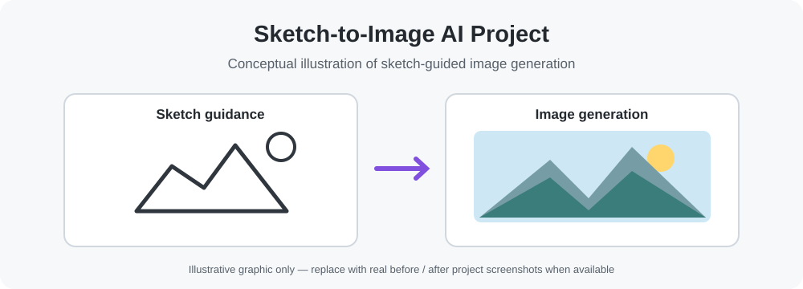
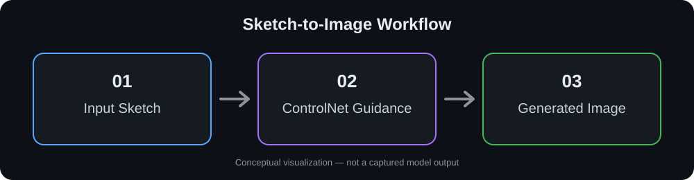

# Sketch-to-Image Generation | Graduation Project

An AI-powered graduation project focused on transforming hand-drawn sketches into generated images using deep learning and **ControlNet**.



## Overview

This project explores sketch-conditioned image generation: a user provides a sketch, which acts as a structural guide for generating a corresponding image. The repository includes project files, ControlNet training-related materials, documentation, presentations, and a demonstration video.

## Project Goals

- Explore AI-based image generation guided by sketches.
- Investigate ControlNet for conditioning image generation on visual input.
- Document the development and model-training process.
- Present results through project materials and a recorded demonstration.

## Technology and Concepts

- **Python** (AI/model-development workflow)
- **Deep Learning**
- **Computer Vision**
- **ControlNet**
- **Sketch-guided image generation**

> For exact runtime dependencies, model weights, and setup commands, refer to the source files in the repository. These details are not specified here to avoid providing unverified installation instructions.

## Repository Structure

```text
Sketch-To-Image-Graduation-Project/
├── Project/                         # Main project files
├── training ControlNet model/       # Model training-related files
├── Cover of Gradation Project/     # Graduation project cover assets
├── Documentation of Graduation Project.pdf
├── First Seminar.pptx
├── Sec Seminar.pptx
├── Final seminar.pptx
└── final.mp4                       # Project demonstration
```

## How It Works (Conceptual Workflow)



1. **Sketch input:** A drawing provides visual guidance.
2. **Image generation:** A ControlNet-based approach uses the sketch as conditioning information.
3. **Generated output:** The result is an image that follows the structure of the input sketch.

*The exact preprocessing steps, models, and application interface should be checked in the project source and documentation.*

## Project Demonstration

[Watch the project demo video](./final.mp4) to see the actual interface and outputs. The diagrams above are conceptual illustrations, not actual model results.

## Documentation and Demo

- [Graduation Project Documentation](./Documentation%20of%20Graduation%20Project.pdf)
- [Final Presentation](./Final%20seminar.pptx)
- [Demonstration Video](./final.mp4)

## Running the Project

The repository contains the project source and training-related files, but installation and execution commands depend on the relevant entry point and environment. Check the `Project/` directory first and review the training folder separately if you want to reproduce the training workflow.

## Potential Improvements

- Add a verified installation guide and dependency list.
- Document the required model weights and dataset setup without committing large generated artifacts.
- Include a few before-and-after sketch/image examples.
- Add reproducible inference instructions and evaluation details.

## Author

**Mohamed H. Eldesouky**  
[GitHub](https://github.com/MMohamedHeshamm)

---

*Academic graduation project — sketch-conditioned AI image generation.*
